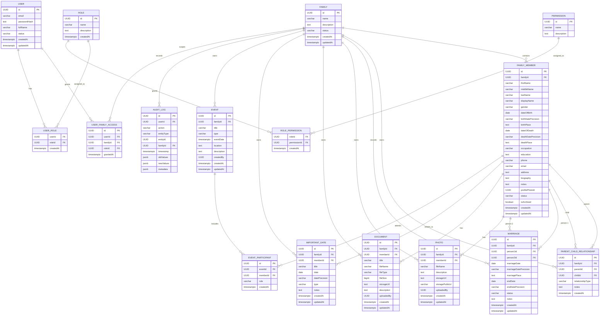

# ER Diagram

This is the final normalized model for a multi-family genealogy system: relationship tables drive the tree, users are scoped by family access, and archive-safe historical records remain intact while derived family views are computed dynamically.
